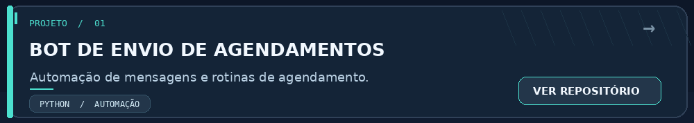
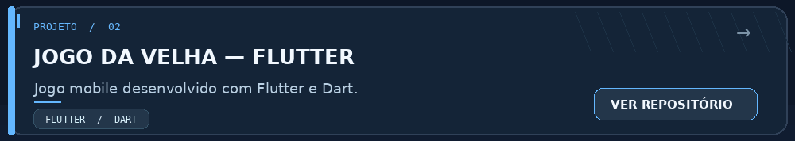
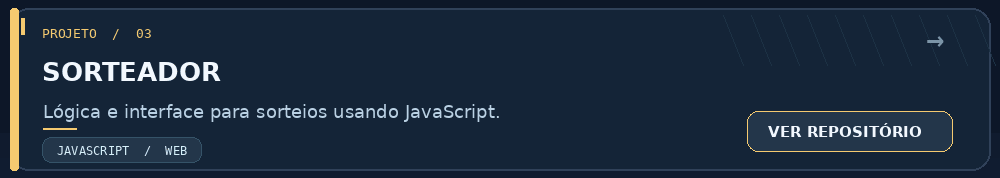
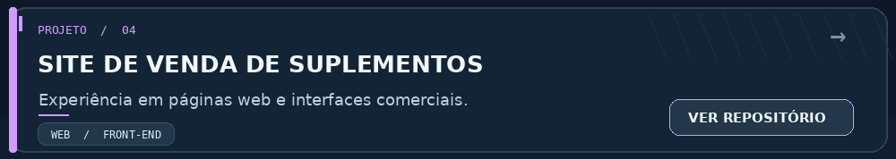
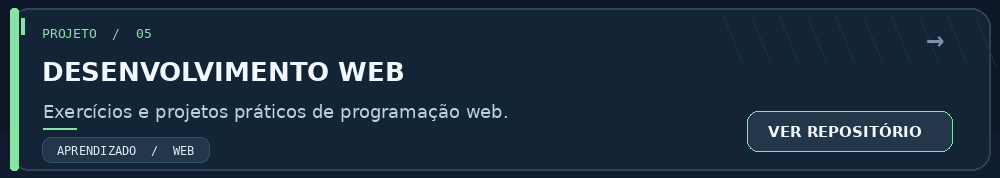

<!-- Perfil de github.com/Vinicius-Tessari | Envie este README e a pasta assets/ -->

  
   
  
   
  <strong>Desenvolvimento de software • Aplicações web • Automação • Bancos de dados</strong>
    
  
  &nbsp;
  
  &nbsp;
  

---

## Sobre mim

Desenvolvo aplicações e automações voltadas à solução de problemas reais. Tenho interesse especial em **desenvolvimento web**, **integração de sistemas** e **bancos de dados**. Meu objetivo é transformar ideias em projetos funcionais, organizados e que possam evoluir com o tempo.

  

## Tecnologias e ferramentas

  

Interfaces: JavaScript, React e Blade (Laravel) · Back-end: PHP, Node.js, Python e Java · Dados: SQL, MariaDB e MySQL · Ferramentas e frameworks: Git, GitHub, VS Code, Flutter, Dart e Django.

## Projetos em destaque

  Selecione um cartão animado para acessar o código no GitHub.
    

  

   
  

## Atividade no GitHub

  
   
  

---

  <strong>Obrigado pela visita!</strong>
   
  Continue explorando. Os projetos estão em constante evolução.
    
  <a href="https://github.com/Vinicius-Tessari?tab=repositories">Ver todos os repositórios</a>

