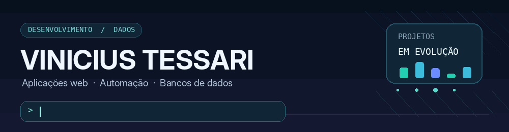
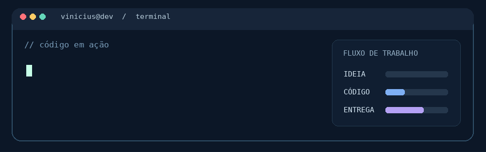
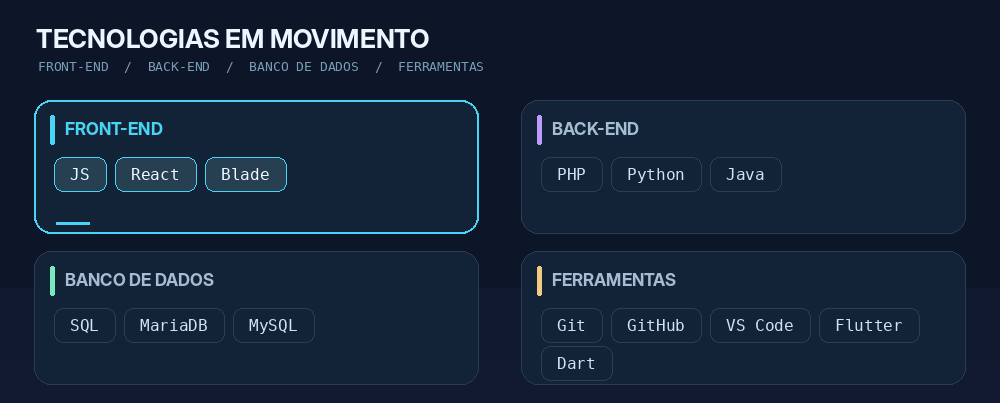

<!--
README de perfil para github.com/Vinicius-Tessari
Para as animações funcionarem, envie a pasta assets/ junto com este README.md.
Não é necessário instalar nada: o GitHub exibe GIFs diretamente no Markdown.
-->

  

   

  

   

  <strong>Desenvolvimento de software • Aplicações web • Automação • Bancos de dados</strong>

    

  <!-- Botões e contador: mantidos sem ícones, combinando com os GIFs do perfil. -->
  
  &nbsp;
  
  &nbsp;
  

---

## Sobre mim

Desenvolvo aplicações e automações voltadas à solução de problemas reais. Tenho interesse especial em **desenvolvimento web**, **integração de sistemas** e **bancos de dados**. Meu objetivo é transformar ideias em projetos funcionais, organizados e que possam evoluir com o tempo.

  

## Tecnologias e ferramentas

  

**Front-end (interfaces):** JS, React e Blade (Laravel)  
**Back-end:** PHP, Python e Java  
**Bancos de dados:** SQL, MariaDB e MySQL  
**Ferramentas e outras tecnologias:** Git, GitHub, VS Code, Flutter e Dart

## Projetos em destaque

| Projeto | Descrição |
| :--- | :--- |
| [Bot de envio de agendamentos](https://github.com/Vinicius-Tessari/Bot-de-envio-de-agendamentos) | Automação em Python para trabalhar com agendamentos. |
| [Jogo da Velha — Flutter](https://github.com/Vinicius-Tessari/Jogo-da-Velha-Flutter) | Aplicação mobile construída com Flutter e Dart. |
| [SORTEADOR](https://github.com/Vinicius-Tessari/SORTEADOR) | Projeto de sorteio desenvolvido em JavaScript. |
| [Site de venda de suplementos](https://github.com/Vinicius-Tessari/Site-Venda-Suplementos) | Experiência com páginas web e JavaScript. |
| [Desenvolvimento Web](https://github.com/Vinicius-Tessari/Desenvolvimento-Web) | Estudos e exemplos práticos de desenvolvimento web. |

## Atividade no GitHub

  

   

  

---

  <strong>Obrigado pela visita!</strong>

   

  Continue explorando. Os projetos estão em constante evolução.

    

  <a href="https://github.com/Vinicius-Tessari?tab=repositories">Ver todos os repositórios</a>

